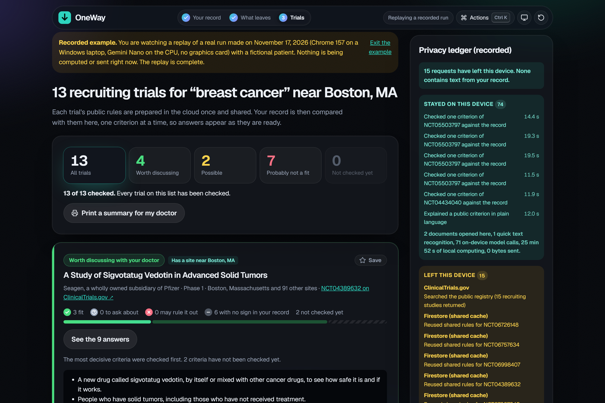
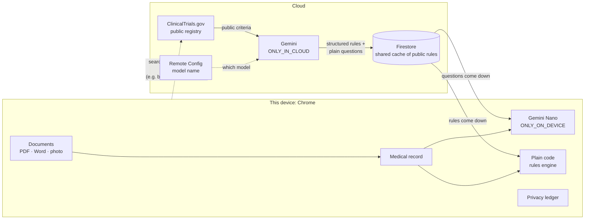

# OneWay — find clinical trials without handing over your medical record

[](https://github.com/Arnaud-TOE/oneway-trials/actions/workflows/ci.yml) [](LICENSE) [](https://oneway-trials.web.app)

**As few as 2 to 4% of newly diagnosed US adults with cancer take part in a clinical trial,**[^participation] and in one survey 43% of
cancer patients said no one had ever talked to them about trials.[^patientpower] Patients who look for one themselves
now paste their medical records into AI chatbots, although most of them worry about where that data goes.[^kff]
OneWay finds recruiting trials and checks their eligibility rules against a medical record, **and the record never
leaves the browser**: Gemini Nano reads it on the device, and the cloud only ever sees public trial rules.

Built for [#BuildHybridAI 2026](https://firebasehybridaihackathon.devpost.com/) with the Firebase AI Logic hybrid
inference SDK, for **Web (Chrome)**.

| | |
|---|---|
| Live app | [oneway-trials.web.app](https://oneway-trials.web.app) (Chrome on a desktop computer) |
| Demo video | *YouTube link added with the Devpost submission* |
| On-device run, recorded | [oneway-trials.web.app/#recorded](https://oneway-trials.web.app/#recorded): a real private run replayed in 75 s, no Gemini Nano needed |
| Evaluation | [bench/RESULTS.md](bench/RESULTS.md): 84.2% agreement with physicians on pairs it had never seen |

[](https://oneway-trials.web.app/#recorded)

> OneWay is not a medical device and does not decide who can join a trial. Only a trial team can. It helps a patient
> prepare a conversation with their doctor.

## TL;DR for judges

- **No Gemini Nano in your Chrome?** Open [oneway-trials.web.app/#recorded](https://oneway-trials.web.app/#recorded),
  or click **Watch a real run, recorded with the on-device model** on the home page. It replays a real
  private run made on a laptop CPU with a fictional patient: a PDF letter and a photo of lab results opened in the
  page, the record read by Gemini Nano, the search approved, 13 trials checked on the device. The replay computes
  and sends nothing; the ledger shows the run's real timings and requests. Or click **Try a fictional patient**:
  fictional patients are not private, so the cloud model stands in and the whole flow runs live.
- **Gemini Nano available** (Chrome 148+)? Drop a PDF, a Word file or a photo of a document, or paste text. It is read
  on your computer: the ledger says **"Nothing has left this device"** until you approve the search, and Chrome's
  network log stays empty. If Chrome still needs to download the model, the app offers a button.
- **The hybrid split is the product.** The cloud reads what is public and long (trial protocols), once per trial,
  cached in Firestore for everyone. The device reads what is private (the record) and answers each criterion with a
  quote from it. All four inference modes are used, each for a reason.
- **The privacy claim is checkable**: a tripwire on every outbound payload, an end-to-end leak test, a Content
  Security Policy, a separate Firebase app instance with no network for on-device calls, and a ledger with the
  exact text of every request.
- **Measured, not claimed**: 84.2% agreement with physicians on 120 unseen patient-criterion pairs from a public NIH
  dataset, where GPT-4 reading the whole note in the cloud scores 93.5%. Privacy costs about nine points; the app
  says so and never says "eligible".

## How we use Firebase AI Logic

Every model call goes through one function, [`generate`](src/lib/hybrid.ts) (or `generateStream` for streamed
image reading). It states the inference mode, refuses any cloud-capable call that carries record text, records
where inference really ran (`response.inferenceSource`) and writes the call to the privacy ledger.

| Capability | Inference mode | Where |
|---|---|---|
| Read a photo or a scanned PDF page (image input, streamed so the text appears as it is written) | `ONLY_ON_DEVICE` | [`transcribe.ts`](src/engine/transcribe.ts) |
| Read the record into a profile: age, sex, diagnosis, treatments, labs (structured JSON output) | `ONLY_ON_DEVICE` | [`profile.ts`](src/engine/profile.ts) |
| Answer each eligibility question with a quote from the record (JSON response constraint) | `ONLY_ON_DEVICE` | [`judge.ts`](src/engine/judge.ts) |
| Compile a trial's public criteria into atomic rules and plain yes/no questions | `ONLY_IN_CLOUD` | [`compile.ts`](src/engine/compile.ts), [`compileCore.ts`](src/engine/compileCore.ts) |
| Explain a public criterion in plain words | `PREFER_ON_DEVICE` | [`explain.ts`](src/engine/explain.ts) |
| Read a built-in fictional patient in a browser without Gemini Nano | `PREFER_ON_DEVICE`, then one batched cloud call per trial | [`profile.ts`](src/engine/profile.ts), [`judge.ts`](src/engine/judge.ts) |
| Summarise a public trial description | `PREFER_IN_CLOUD` | [`explain.ts`](src/engine/explain.ts) |
| Download the on-device model, with progress | `initializeDeviceModel` | [`hybrid.ts`](src/lib/hybrid.ts) |

Engineering details that matter:

- **Two Firebase app instances.** Cloud-capable calls use the main app, with App Check. Strictly on-device calls use a
  second instance with no App Check and no sign-in ([`getDeviceAi`](src/lib/firebase.ts)): reading a record loads
  nothing and contacts no server, not even the reCAPTCHA script, and an on-device call that ever tried to reach the
  cloud would carry no App Check token and be refused.
- **Resilience.** A transient on-device error (`kErrorUnknown`) is retried once in the same mode; a "quota exceeded"
  answer twice (12 s, 25 s); a server error ("high demand") three times (2, 6, 15 s), then optionally a fallback
  model named in Remote Config. A call the person stops is never retried.
- **The model name comes from Remote Config**, as the AI Logic production checklist recommends. The fallback is off by
  default, on a measurement: on 17 November 2026, on the no-cost tier, `gemini-3.5-flash-lite` compiled a trial in
  2.5 s while `gemini-4-hydrogen` answered "high demand" and `gemini-3.8-flash` had not answered after 130 s.

### Other Firebase products

| Product | Role |
|---|---|
| App Check | Protects the Gemini API: reCAPTCHA Enterprise in production, debug provider locally. Loaded only at the first cloud call. |
| Authentication | Anonymous sign-in: cloud requests are authenticated, but nobody creates an account. |
| Cloud Firestore | Shared, write-once cache of compiled public trial rules, with an offline cache. [Security rules](firestore.rules) make it impossible to store anything else, and tie every entry to its trial, source text and compiler version. |
| Remote Config | `model_name` and an optional `fallback_model_name`. Template versioned in [`remoteconfig.template.json`](remoteconfig.template.json), client in [`remoteConfig.ts`](src/lib/remoteConfig.ts), loaded on demand. |
| Hosting | Serves the app, with security headers and a Content Security Policy in [`firebase.json`](firebase.json). |

## What makes this different

- **Nothing personal goes up, not even redacted.** Apps that mask personal data before calling the cloud depend on a
  detector that can miss something. Here there is nothing to miss: the cloud's prompts are built only from public
  registry text.
- **A privacy claim you can check yourself**: the ledger, Chrome's network log, the CSP header, the leak test.
- **Measured against physicians** on a public NIH dataset, with the losses stated next to the wins.
- **It gets cheaper and faster with use.** Each trial is compiled once and shared through Firestore; a judge or a
  patient who arrives later reads the rules from the cache, and checking continues offline.
- **Documents, not just text.** PDFs, Word files and photos are opened in the page. A photo is read twice, by
  Tesseract (WebAssembly, a second) and by Gemini Nano (careful, multimodal), and every line where the two disagree
  on a number or the spelling of a word is shown to the person to check.
- **Built for the weeks after the first search**: saved trials with their status and a note, answers the person gives
  themself (shown as theirs, never as read in the record), the study team's public contact, an optional memory kept
  only in this browser, and a calendar reminder that names no condition.

## Architecture



1. **The device reads the record**: pasted, or opened from documents in the page. Text layers are read by plain code;
   photos and scanned pages by Tesseract and Gemini Nano. A long record is read in parts of 9,000 characters, so
   nothing is cut off.
2. **The person approves the search.** Only a short condition name and an optional place go out, shown word for word
   first.
3. **The cloud compiles each trial once** into atomic criteria, marks those plain code can check, and rewrites the
   others as plain questions. The result is public, cached in Firestore and shared.
4. **The device matches.** Plain code decides numeric and categorical criteria; Gemini Nano answers the rest one at a
   time, quoting the record. The most decisive criteria are asked first, and a trial stops at its first blocker.
5. **The ledger** lists what stayed on the device and every request that carried content off it, with its exact text.

## Privacy you can check

- **Structure.** Cloud prompts are built only from public registry text.
- **A tripwire** ([`privacy.ts`](src/engine/privacy.ts)). The record and every document are fingerprinted; a payload
  about to leave the device that carries a passage of them throws before the SDK is called.
- **An end-to-end test** ([`leak.test.ts`](src/engine/__tests__/leak.test.ts)). The SDK is replaced by a recorder; the
  test fails if any call that carries record text is not `ONLY_ON_DEVICE`, or is handed to the instance with network
  credentials.
- **Silence while the record is read.** No request at all until the person approves the search, checked in Chrome's
  network log on the live app.
- **The browser enforces it too.** The site's Content Security Policy lets the page connect only to itself,
  ClinicalTrials.gov and the Firebase and Google endpoints it needs. Even a bug in OneWay could not send the record
  anywhere else.
- **Documents stay local.** pdf.js, Tesseract and its English data are served by the site itself; with their files
  removed they fail rather than fetch anything from a CDN.
- **Fail closed.** With no on-device model, a real record is refused, and nothing is sent.

## What keeps the answers honest

A small on-device model makes mistakes. Each of these guards was added after observing a real error:

- **Plain code first.** Age, sex, performance status and lab thresholds are decided by code, with exact unit
  conversions (a trial's "hemoglobin ≥ 90 g/L" against a record's 12.1 g/dL).
- **Quotes are verified.** A quote is shown only if it appears word for word in the record. No quote, no verdict.
- **Exclusions are judged as physicians judge them.** An exclusion counts against the patient only when the record
  shows it; otherwise the app says "nothing in your record suggests this", as an assumption, in a separate group.
- **Evidence must fit the question.** A sentence about an absence ("She has never received chemotherapy") cannot prove
  that an exclusion applies, and the patient's own cancer cannot prove "another malignancy".
- **Extracted facts are checked.** Numbers must appear in the record; "never received" is found by plain code, and a
  "never received" from the model that no sentence supports is overruled.
- **The cloud writes the questions** in plain words: registry wording such as "one of the following cancers" misled
  the on-device model.
- **Cautious wording.** Never "eligible": worth discussing with a doctor, possible, or probably not a fit, with what
  the record does not say listed as questions to ask.

## Evaluation

Measured against physicians' annotations from the public NIH/NCBI TrialGPT dataset, using the product's own
on-device code path in Chrome on a laptop CPU.

**On 120 pairs the pipeline had never seen** (a random draw, natural mix of answers):

| | Same answer as physicians | Correct when it answers yes/no | False blockers |
|---|---|---|---|
| **OneWay, record kept on the device** | **84.2%** | 82.8% | 5 of 120 |
| OneWay, cloud path (built-in fictional patients only) | 82.5% | 81.1% | 4 of 120 |
| GPT-4 reading the whole note in the cloud, as published | 93.5% | 94.5% | 2 of 107 |

**On a harder sample of 120 pairs**, built to contain every pair physicians marked as ruling a trial out, each part of
the design adds something:

| Variant | Same answer as physicians | Blockers found | Blockers shown as fine | False blockers |
|---|---|---|---|---|
| On-device model alone, registry wording | 46.7% | 7 of 33 | 2 of 33 | 3 of 87 |
| + one plain question written by the cloud | 56.7% | 13 of 33 | 4 of 33 | 1 of 87 |
| + cloud splits criteria, code checks age and sex | 60.0% | 18 of 33 | 3 of 33 | 3 of 87 |
| + exclusions judged as physicians do (current) | 64.2% | 18 of 33 | 4 of 33 | 4 of 87 |
| GPT-4 in the cloud, as published | 89.5% | 28 of 33 | 2 of 33 | 1 of 81 |

- **The hybrid split is what makes the small model useful**: from 47% to 64% agreement on the hard sample, and more
  than twice as many blockers found, without the cloud ever seeing the record.
- **Privacy costs about nine points** on unseen pairs (84% against 93.5%).
- **It still makes harmful mistakes**, which is why it shows the quote behind every answer and never says "eligible".
- The numbers were measured with `gemini-3.5-flash-lite`, the default `model_name`. The guards added on 17 November
  (unit conversions, evidence that must fit the question) were checked on the bench's recorded answers, where they
  change nothing, but not yet on new pairs.

Method, samples, confusion tables, rejected ideas and how to rerun it: [bench/RESULTS.md](bench/RESULTS.md).

## Run it locally

You need Node.js 20 or later and Chrome 148 or later on a desktop computer (Windows 10/11, macOS 13+ or Linux). For
on-device inference Chrome needs 22 GB of free disk space and either a GPU with more than 4 GB of VRAM or 16 GB of RAM
and 4 CPU cores ([Chrome requirements](https://developer.chrome.com/docs/ai/get-started)).

1. `npm install`
2. In the Firebase console, create a project, open **AI Logic** and choose the Gemini Developer API (this enforces App
   Check). Enable **Authentication → Anonymous** and create a **Firestore** database.
3. Copy `.env.example` to `.env.local` and fill in your web app configuration.
4. `npm run deploy:rules`, and optionally `npx firebase deploy --only remoteconfig` (in-app defaults apply without it).
5. `npm run dev`, open http://localhost:5173, and register the **App Check debug token** printed in the browser console
   (App Check → Apps → Manage debug tokens). Never commit it.

If Chrome reports image input as unavailable, enable `chrome://flags/#prompt-api-for-gemini-nano-multimodal-input`.

Development pages, never part of the production build: `#bench` and `#bench-test` (the evaluation bench), `#engine`
(one trial through the engine) and `#warm` (prepares the shared cache for the fictional patients).

## Checks

```bash
npm run typecheck
npm test
npm run build
```

163 tests, including the end-to-end privacy test and checks on the recorded example (complete, made on the device,
no outbound request carrying record text). CI ([`.github/workflows/ci.yml`](.github/workflows/ci.yml)) runs all three
on every push, and `npm install` turns on a pre-push hook that runs them locally and refuses to push an `.env` file.

## Project layout

```
src/lib/hybrid.ts         the single entry point for every model call
src/lib/firebase.ts       Firebase, App Check, anonymous Auth, Firestore, the on-device instance
src/lib/remoteConfig.ts   cloud model names from Remote Config
src/engine/               privacy tripwire, ledger, registry client, cloud compiler, rules engine,
                          on-device reader and judge, documents, long records in parts
src/app/                  the interface; recorded/ holds the recorded example
src/bench/, bench/        evaluation bench: pages, data, scripts and results
src/spike/                development pages
scripts/                  vendor files for pdf.js and Tesseract; cleaning of a recorded run
firestore.rules           rules for the shared cache
remoteconfig.template.json, firebase.json   Remote Config template; hosting, headers and CSP
AGENTS.md                 the invariants any coding agent must keep
```

## What it doesn't do (yet)

- On-device inference needs Chrome on a desktop computer with enough disk and memory. On a laptop CPU with no graphics
  card each judged criterion takes 10 to 25 seconds; the recorded run took 22 minutes for 13 trials.
- The on-device model reads English best. The interface is in English.
- A photo's careful reading takes about 20 seconds plus 0.08 seconds per character on a laptop CPU, about 3 minutes
  for a full page. The quick reading shows the text in a second or two meanwhile, but misreads digits on blurred
  photos; the app says so.
- A long record is read in full, up to 6 parts (about 51,000 characters) and 40 PDF pages; each part adds the same time
  again. Older formats (.doc, .rtf, HEIC photos) are not opened.
- The registry search sends a condition name and a place to ClinicalTrials.gov, which the person sees and approves.
- The plain questions written by the cloud model cannot be verified word for word the way quoted criteria are, and
  the on-device model still sometimes quotes a sentence that does not prove what it claims.
- App Check uses Google reCAPTCHA Enterprise in production: Google's script runs inside the page once a cloud call is
  needed (for a real record, after the search is approved). A browser that reCAPTCHA scores as automated can be
  refused the cloud; reading a real record never needs it.
- The shared cache can be written by any signed-in copy of the app (write-once, key tied to a hash of the public
  criteria text). Cached quotes are re-checked against the registry text, but a rule's logic is trusted as written.
- Results depend on what the record says. A criterion the record does not mention is reported as an open question.

## Credits

Everything in this repository was written during the submission period (11–30 November 2026), with Claude Code as
the coding agent and the official [Firebase Agent Skills](https://firebase.google.com/docs/ai-assistance/agent-skills)
plugin (`firebase@firebase`, declared in [`.claude/settings.json`](.claude/settings.json)):

- `firebase-ai-logic-basics`: the setup checked against its production advice (App Check, current model names, the
  model name in Remote Config), which led to the Remote Config integration.
- `firebase-remote-config-basics`: the template workflow (in-app defaults, `fetchAndActivate`, a template file
  deployed with the CLI, `remoteconfig:versions:list` to verify).
- `firebase-security-rules-auditor`: a red-team review of [`firestore.rules`](firestore.rules). No access leak; three
  minor issues fixed (the trial id was checked through a regular expression built from user data; the source hash and
  compiler version were not tied to the document key), and four forged writes then refused by the server.

Data: [ClinicalTrials.gov](https://clinicaltrials.gov) (public registry, API v2) and the NIH/NCBI TrialGPT criterion
annotations (public domain, synthetic patients) for the evaluation. Every patient in this repository is fictional.

Libraries, all served with the app (no CDN): Firebase JS SDK and React; Mozilla pdf.js and Tesseract.js with its
English data (Apache-2.0); idb-keyval (Apache-2.0); Lucide icons (ISC); the Geist and Instrument Serif fonts (SIL Open
Font License).

## License

[Apache-2.0](LICENSE)

[^participation]: Ramers-Verhoeven et al., *Exploratory research into cancer patients' attitudes to clinical trials*,
    ecancermedicalscience, 2014: "as few as 2–4% of all newly diagnosed adult US cancer patients participate".
    [PMC4027888](https://pmc.ncbi.nlm.nih.gov/articles/PMC4027888).
[^patientpower]: Patient Power survey of 666 people with cancer (2020): 43% said no healthcare professional had talked
    to them about trials, and 76% would probably have taken part if asked.
    [Clinical Research News](https://www.clinicalresearchnewsonline.com/news/2020/03/04/patient-power-survey-reveals-nearly-half-of-cancer-patients-never-discuss-clinical-trials-with-doctors).
[^kff]: KFF tracking poll (24 February to 2 March 2026, 1,343 adults): 41% of people who use AI for health
    information have uploaded personal medical information, while 77% of adults worry about the privacy of medical
    information given to AI tools.
    [KFF](https://www.kff.org/public-opinion/kff-tracking-poll-on-health-information-and-trust-use-of-ai-for-health-information-and-advice/).
